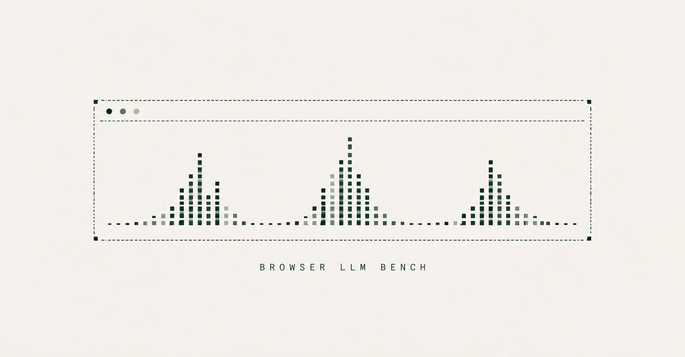

I started benchmarking small language models because I wanted to know which ones I could realistically keep running inside a browser.

In my [recent writing about browser intelligence](/blogs/intent-alignment/), I explored what becomes possible when a model can help interpret the page someone is working on. Running that interpretation locally is appealing: sensitive page content can stay on the device, and inference does not need a round trip to a model API.

But the work still has to happen somewhere. Now it shares a machine with the user's tabs, video calls, editor, and everything else they are doing.

Getting a model to produce a response left me with a more practical question: **would I want it running while I used the rest of my browser?**

That's why I built [Browser LLM Bench](https://browserllm.dev).

## The cost of staying local

A fast response is encouraging. It tells you very little about how much memory the model keeps between requests, whether the page stays responsive, or what happens when you unload it.

Those questions affect the design of the feature itself. Keeping a model loaded might make the next interaction quicker, but it also means holding resources while the user is doing something else. Loading it only when needed changes that trade-off again.

I wanted to see the whole session: load the model, use it, leave it alone, come back, and eventually release it. The pauses are part of what I wanted to understand. A browser feature may sit unused for minutes between interactions.

Browser LLM Bench puts that session alongside the familiar speed and latency measurements. Resource usage gets the same attention as response time. You can see when the activity happened and inspect the configuration behind it.

## What became clearer

The first comparison covers ten 4-bit model configurations. One useful example came from Llama 3.2 1B and Qwen2.5 0.5B: on the test machine, Llama generated text faster, while Qwen had a lower sampled peak browser memory footprint.

That gives me a more useful starting point for a decision. For an occasional background feature, I might care more about the memory it holds. For something the user waits on repeatedly, response time may matter more. Either choice still needs an answer to whether the model can do the actual task well.

The measurement work also forced me to be more careful about the numbers. Browser memory, model allocations, and whole-machine GPU activity can all produce convincing charts while describing different things. I wanted the report to make those boundaries visible, so someone reading it can judge what the result supports.

The outcome is a way to narrow the models worth trying and understand the costs to investigate before building around one.

## A place to start

You can explore the [published results](https://browserllm.dev), open the reports behind them, or [run a benchmark on your own device](https://browserllm.dev/run/). Your local results stay in your browser and can be downloaded. They do not change the public leaderboard.

The [source and local profiling harness](https://github.com/gufranmirza/browser-llm-bench) are available, along with the [measurement methodology](https://browserllm.dev/methodology/).

There is still a substantial piece to add: task quality. The current sessions repeat a short prompt to measure performance; they do not establish accuracy or reasoning ability. I want to bring those evaluations together with resource budgets, because a useful browser model needs to produce a good answer within the resources the application can afford.

For now, Browser LLM Bench gives me something I was missing when I started: a clearer basis for choosing what to test next, and evidence I can inspect when the trade-offs are less obvious than a speed ranking suggests.
